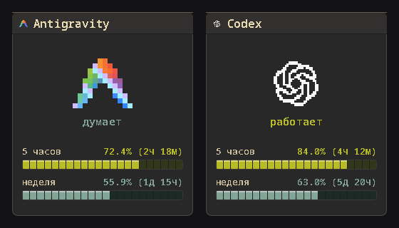
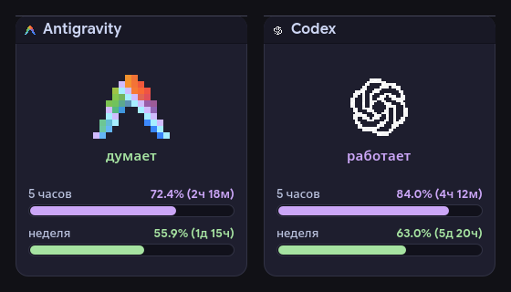
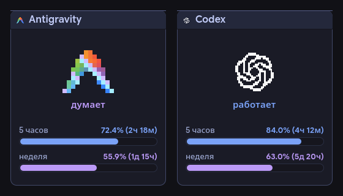

# Plasma AI Status


Пиксельный виджет активности и лимитов **Antigravity CLI** и **OpenAI Codex**.
Каждый экземпляр независимо выбирает сервис, тему и оформление.
Размер нового виджета по умолчанию — **256 × 288**; логотипы вписаны в одинаковую область.


**Один виджет — два сервиса.** Добавьте два экземпляра: один для Antigravity, второй для Codex.
У каждого свои активность, лимиты, таймеры сброса, настройки и логотип.

| Сервис | Логотип | Источник лимитов |
|---|---|---|
| **Google Antigravity CLI** | Пиксельный логотип Antigravity | Команда `agy /usage`, группа Gemini Models |
| **OpenAI Codex** | Пиксельный логотип OpenAI | Официальный метод `account/rateLimits/read` через локальный `codex app-server` |

## Скриншоты

Слева — **Antigravity**, справа — **Codex**. В обоих экземплярах размер 256 × 288.
Квоты на скриншотах демонстрационные; изображения отрисованы из компонентов виджета.

| Retro Pixel | Material 3 Expressive |
|---|---|
|  |  |

<details>
<summary>Ещё пять тем</summary>

| Windows 95 Classic | Cyberpunk 2077 |
|---|---|
|  |  |

| Gruvbox Retro | Catppuccin Mocha |
|---|---|
|  |  |



</details>

## Два виджета рядом

1. Добавьте **Plasma AI Status** на рабочий стол или панель дважды.
2. В настройках первого экземпляра откройте **Основные → Service → Antigravity (agy)**.
3. Во втором выберите **OpenAI Codex**.

Заголовок и пиксельная иконка переключаются автоматически: `antigravity.sh` с логотипом Antigravity
или `codex.sh` с пиксельным логотипом OpenAI. Собственный заголовок можно задать во вкладке «Внешний вид»;
пустой заголовок включает автоматический выбор. Старые стандартные заголовки также работают автоматически.
В панели нажатие на иконку открывает полный виджет.

Темы, настройки и данные экземпляров независимы. Проект ранее назывался `plasma-antigravity`.
Существующие экземпляры после обновления
продолжают показывать Antigravity. Идентификатор пакета `org.kde.plasma.antigravity` сохранён,
чтобы не терять настройки и размещение виджетов.

## Данные и активность

- **Antigravity:** настоящие лимиты группы Gemini Models из
  `agy -p /usage --output-format json`. Группы Claude/GPT и Gemini 4 Argon не смешиваются с Gemini Models.
  Активность интерактивного CLI и фоновых запусков `-p` / `--print` / `--prompt`
  определяется по процессам и открытым SQLite-журналам сессий. TTY не требуется.
  Служебные запросы `/usage` не считаются работой агента. Длительные запросы
  продолжают отображаться активными, пока жива связанная сессия.
- **Codex:** официальный метод `account/rateLimits/read` через `codex app-server`.
  Используются основные лимиты `codex`, без запуска модельного запроса.
  Из `usedPercent` вычисляется остаток; время сброса берётся из `resetsAt`.
  Активность определяется по недавним локальным журналам `sessions/**/*.jsonl`
  (запрос, вызовы инструментов, завершение и отмена). Это приближённый локальный индикатор:
  облачные сессии без локального журнала он не отслеживает.
- Два окна лимитов обычно соответствуют **5 часам** и **неделе**.
  Для Codex подписи следуют фактической длительности окна в ответе сервера.
- Квоты обновляются в фоне раз в 60 секунд, включая время, когда CLI закрыт.
  Последние успешные квоты находятся в `$XDG_STATE_HOME/plasma-agent-status`
  (по умолчанию `~/.local/state/plasma-agent-status`) и сохраняются после перезагрузки.
  Предыдущий кэш из `~/.cache/plasma-agent-status` переносится автоматически.
  Для Codex учитывается `CODEX_HOME`.
  Несколько экземпляров одного сервиса совместно используют кэш и блокировку обновления.
- Пока данных нет, показывается **«нет данных»**. При ошибке сохраняется последняя успешная квота;
  ошибка и предупреждение об устаревших данных доступны в подсказке.
  Частичный ответ сохраняет последнюю известную квоту другого окна.
  Снимок квот также хранится в настройках каждого экземпляра, чтобы восстановить
  проценты сразу при загрузке интерфейса. Автоматического сброса на 100% нет.
  Таймеры сброса пересчитываются при каждом опросе из абсолютного времени.

Для доступа к лимитам предварительно войдите в соответствующий CLI:

```bash
agy
codex login
```

У Codex нужна авторизация с подпиской ChatGPT, предоставляющей лимиты Codex.
Для API-key-only аккаунтов такие лимиты могут быть недоступны.
Виджет не читает и не копирует токены из файлов авторизации.

## Установка и обновление

```bash
git clone https://github.com/skippingclass/plasma-ai-status.git
cd plasma-ai-status
./install.sh
```

Для существующей копии:

```bash
git remote set-url origin git@github.com:skippingclass/plasma-ai-status.git
git pull --ff-only
./install.sh
```

После обновления уже загруженных QML-компонентов перезапустите Plasma:

```bash
systemctl --user restart plasma-plasmashell.service
```

Добавление: ПКМ по рабочему столу → «Добавить виджеты…» → **Plasma AI Status**.

```bash
./test.sh                    # Отдельное окно Plasma
./install.sh --uninstall      # Удаление
```

Требования: KDE Plasma 6, Python 3, соответствующий CLI (`agy` / `codex`) в PATH оболочки Plasma.

## Настройки

**Основные:** сервис, автоматический мониторинг, интервал активности (1–60 секунд),
необязательный пользовательский исполняемый скрипт с JSON на stdout.

**Внешний вид:** тема, заголовок, акцент, сегментированные или плавные полосы,
размер и анимация логотипа, десятые процента и таймеры сброса.

Доступны семь тем: Retro Pixel, Material 3 Expressive, Windows 95 Classic,
Cyberpunk 2077, Gruvbox Retro, Catppuccin Mocha и Tokyo Night.

## Проверка провайдеров

```bash
python3 contents/scripts/status_provider.py --provider antigravity
python3 contents/scripts/status_provider.py --provider codex
# Дождаться сетевого обновления кэша:
python3 contents/scripts/status_provider.py --provider codex --refresh-only
python3 -m unittest discover -s tests -v
```

Обычный вызов немедленно возвращает кэш и при необходимости запускает фоновое обновление.
Пользовательский скрипт по-прежнему можно передать позиционным аргументом.

## Обновить скриншоты

Рендер использует настоящие QML-компоненты и фиксированные демонстрационные данные,
не запускает агентов и не обращается к аккаунтам. Нужен Python с PySide6:

```bash
python3 tools/render_screenshots.py
```

## Лицензия

MIT © 2026 [skippingclass](https://github.com/skippingclass). См. [LICENSE](LICENSE).
